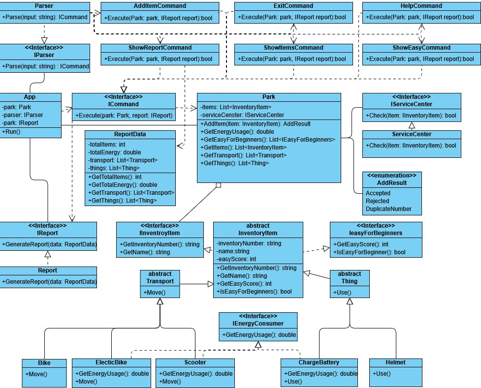

## Работа программы

Доступные команды:

- `help` — вывести помощь
- `add <type> <number> <name> <easyScore> (<energyKwh>)` — добавление в парк устройства
- `report` — вывод отчета по парку
- `list` — вывод списка устройств
- `easy` — вывод списка простых устройств
- `exit` — выход из программы

Например:

```text
> help
> add scooter SC-001 Xiaomi 8 1.5
> add bike B-001 Stels 5
> report
> easy
> exit
```

Особенности программы:

- Обработка входных данных с помощью паттерна Command
- Передача данных из парка через DTO (`ReportData`)
- Использование DI-контейнера (зависимости собираются в `Main`)

Диаграмма зависимостей:


## Обязательные вопросы

1. В основе своей все принципы SOLID выполняются.

   - **S:** Каждый класс выполняет только одно действие: сервисный центр — проверяет инвентарь, парк — хранит инвентарь (в данном случае; также может хранить сотрудников и другое).
   - **O:** Легко добавить новый транспорт, предмет или команду, не переписывая при этом код.
   - **L:** Выполняется при наследовании.
   - **I:** Каждый интерфейс выполняет только одну функцию. Например, `IEasyForBeginners` отвечает только за свойство простоты для использования.
   - **D:** Модули зависят от интерфейсов (`IParser`, `IReport`), а не от реализаций (`Parser`, `Report`).

2. **S** не совсем выполняется, так как разные классы (`AddItemCommand`, `ShowReportCommand`) делают вывод в консоль. Следует написать единственный класс, который осуществляет вывод в консоль. В данном случае это будет оверинжинирингом.

   **O** не совсем выполняется, так как парсер не только парсит строку, но и создает объекты. По хорошему следует вынести создание объектов в отдельный класс, но я считаю, что это тоже будет оверинжиниринг для небольшого сервиса. При расширении следует дописать класс для создания объектов.

   **I** не совсем выполняется, так как некоторые команды не используют все параметры в `Execute`. По идее следует вместо одного интерфейса использовать несколько (более общий и более узкие), но здесь это будет лишним.

   **D** не совсем выполняется, так как нет интерфейса парка, но по задумке парк должен быть единственным, так что это не критично.

3. Ничего не сломается, но возможно придется дописывать парсер и генератор отчета под новые условия.

4. Решение техосмотра проверяется тестами `AddItem_ServiceCenterAccepts_ReturnsAccepted` и `AddItem_ServiceCenterRejects_ReturnsRejected`.  
   Сервисный центр подменяется моком:

   ```csharp
   private static Park CreatePark(bool serviceCenterResult = true)
   {
       var serviceCenter = Substitute.For<IServiceCenter>();
       serviceCenter.Check(Arg.Any<IInventoryItem>()).Returns(serviceCenterResult);
       return new Park(serviceCenter);
   }
   ```

5. Парсер и HelpCommand написаны нейросетью.