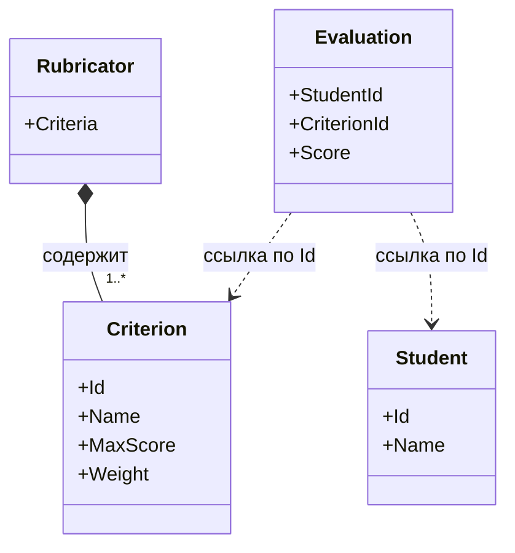

# README.md

# ПОС — Преподавательская Оценка Студентов

Консольный модуль учёта преподавательской оценки студентов. Домашнее задание №2
по курсу "Конструирование программного обеспечения".

## Содержание

- [Запуск](#запуск)
- [Стек](#стек)
- [Архитектура](#архитектура)
- [Структура решения](#структура-решения)
- [Domain](#domain)
  - [Ubiquitous Language](#ubiquitous-language)
  - [Entity и Value Object](#entity-и-value-object)
  - [Агрегаты](#агрегаты)
  - [Инварианты](#инварианты)
  - [Domain Service](#domain-service)
  - [Порты](#порты)
  - [Исключения](#исключения)
- [Application](#application)
- [Infrastructure](#infrastructure)
- [Console](#console)
- [Паттерны GoF](#паттерны-gof)
- [DI-контейнер](#di-контейнер)
- [Тесты](#тесты)
- [Демо-сценарий](#демо-сценарий)
- [Что считается дублем оценки](#что-считается-дублем-оценки)
- [Что осознанно не делалось](#что-осознанно-не-делалось)
- [Роль ИИ](#роль-ии)
- [Чек-лист по ТЗ](#чек-лист-по-тз)

---

## Запуск

```bash
# Меню
dotnet run --project src/TasApp.Console

# Демо-сценарий (data/demo/)
dotnet run --project src/TasApp.Console -- demo

# Тесты
dotnet test
```

---

## Стек

- .NET 10, C# 14
- Microsoft.Extensions.DependencyInjection
- System.Text.Json
- xUnit, FluentAssertions, NSubstitute

---

## Архитектура

Clean Architecture / Ports & Adapters. Зависимости направлены внутрь:

```
┌─────────────────────────────────────────────────┐
│  Frameworks & Drivers                           │
│  TasApp.Console, TasApp.Infrastructure          │
│                                                 │
│  ┌───────────────────────────────────────────┐  │
│  │  Interface Adapters                       │  │
│  │  Json*Repository, CsvFinalScoreExporter,  │  │
│  │  ConsoleController                        │  │
│  │                                           │  │
│  │  ┌─────────────────────────────────────┐  │  │
│  │  │  Application                        │  │  │
│  │  │  Use Cases, TasFacade, DTOs         │  │  │
│  │  │                                     │  │  │
│  │  │  ┌───────────────────────────────┐  │  │  │
│  │  │  │  Domain                       │  │  │  │
│  │  │  │  Entities, VO, Services,      │  │  │  │
│  │  │  │  Factories, Ports, Exceptions │  │  │  │
│  │  │  └───────────────────────────────┘  │  │  │
│  │  └─────────────────────────────────────┘  │  │
│  └───────────────────────────────────────────┘  │
└─────────────────────────────────────────────────┘

Console/Infrastructure → Application → Domain
Domain не ссылается ни на Application, ни на Infrastructure, ни на Console.
```

---

## Структура решения

```
TasApp.sln
├── src/
│   ├── TasApp.Domain/            class library
│   ├── TasApp.Application/       class library
│   ├── TasApp.Infrastructure/    class library
│   └── TasApp.Console/           exe
└── tests/
    └── TasApp.Tests/             xUnit
```

Ссылки между проектами:

| Проект | Ссылается на |
|---|---|
| `TasApp.Domain` | — |
| `TasApp.Application` | `TasApp.Domain` |
| `TasApp.Infrastructure` | `TasApp.Domain`, `TasApp.Application` |
| `TasApp.Console` | все |
| `TasApp.Tests` | `TasApp.Domain`, `TasApp.Application`, `TasApp.Infrastructure` |

---

## Domain

### Ubiquitous Language

| Термин | Определение | Роль |
|---|---|---|
| Студент | Тот, кого оценивают | Entity |
| Критерий | То, за что ставят балл. Имеет maxScore и вес | Entity внутри Rubricator |
| Рубрикатор | Набор критериев | Aggregate Root |
| Балл | Числовое значение, которое ставят по критерию | VO `Score` |
| Оценка | Факт "студенту X по критерию Y поставили балл Z" | Entity + Aggregate Root |
| Итог | Результат по студенту, вычисленный из оценок и рубрикатора | VO `FinalScore` |
| Расчёт итога | Правило вычисления итога | Domain Service |


### Entity и Value Object

**Entity**:

- `Student`, `Criterion`, `Rubricator`, `Evaluation`.

**Value Object**:

- `Score`, `MaxScore`, `Weight`, `FinalScore`.
- `StudentId`, `CriterionId`, `EvaluationId` — типобез опасные идентификаторы.
- `StudentName`, `CriterionName` — непустые строки с trim.

VO — `readonly record struct` с валидацией в конструкторе.

### Агрегаты

Три агрегата:



- `Criterion` — entity внутри `Rubricator`, конструктор `internal`.
  Снаружи доступен только через методы корня. Отдельного `ICriterionRepository`
  нет.
- `Evaluation` ссылается на другие агрегаты только по Id. Загрузка одной оценки
  не тянет студента и рубрикатор.
- Правило "критерий из рубрикатора" межагрегатное: проверяется в use case через
  `Rubricator.GetCriterion(...)` до создания оценки.

### Инварианты

| Инвариант | Где охраняется |
|---|---|
| `score >= 0` | `Score` ctor |
| `score <= criterion.MaxScore` | `Evaluation.Create`, `Evaluation.ChangeScore` |
| `maxScore > 0` | `MaxScore` ctor |
| `weight > 0` | `Weight` ctor |
| `finalScore >= 0` | `FinalScore` ctor | 
| имя не пустое | `StudentName` / `CriterionName` ctor |
| критерий из рубрикатора | `Rubricator.GetCriterion(...)` в use case |
| критерии только через рубрикатор | `Criterion` ctor и сеттеры `internal` |
| уникальные имена критериев при batch-сборке | `RubricatorBuilder.Build()` |
| одна оценка на пару (студент, критерий) | `AssignEvaluationUseCase` через `IEvaluationRepository.FindByStudentAndCriterionAsync` |

Верхняя граница `score <= maxScore` в `Score` не проверяется: `maxScore` живёт
в другом агрегате, поэтому проверка в `Evaluation`.

### Domain Service

`FinalScoreCalculator` — расчёт итога. Делегирует формулу в `IFinalScoreStrategy`.

Реализации:

- `WeightedSumStrategy` — `sum(score/maxScore) * weight`.
- `PercentStrategy` — итог в шкале 0..100.
- `StrictWeightedSumStrategy` — требует оценок по всем критериям, иначе
  `MissingEvaluationsException`.

### Порты

Расположены в Domain. Домен объявляет, что ему нужно для хранения, а инфраструктура реализует.

| Порт | На какой агрегат | Методы |
|---|---|---|
| `IStudentRepository` | `Student` | `AddAsync`, `GetByIdAsync`, `ListAsync`, `UpdateAsync` |
| `IRubricatorRepository` | `Rubricator` (с Criteria) | `GetAsync`, `SaveAsync` |
| `IEvaluationRepository` | `Evaluation` | `AddAsync`, `GetByIdAsync`, `ListByStudentAsync`, `UpdateAsync`, `DeleteAsync`, `FindByStudentAndCriterionAsync` |

### Исключения

Все наследуются от `DomainException`.

| Исключение | Где |
|---|---|
| `ScoreOutOfRangeException` | `Evaluation.Create` / `ChangeScore`, `Score` ctor |
| `CriterionNotFoundInRubricatorException` | `Rubricator.GetCriterion` |
| `InvalidMaxScoreException` | `MaxScore` ctor |
| `InvalidWeightException` | `Weight` ctor |
| `InvalidStudentNameException` | `StudentName` ctor |
| `InvalidCriterionNameException` | `CriterionName` ctor |
| `InvalidFinalScoreException` | `FinalScore` ctor |
| `MissingEvaluationsException` | `StrictWeightedSumStrategy` |
| `DuplicateCriterionNameException` | `RubricatorBuilder.Build` |

---

## Application

Слой сценариев. Содержит Commands, Queries, DTO, Use Cases, Facade, Application
исключения.

### Use Cases

| Use Case | Что делает |
|---|---|
| `AddStudentUseCase` | Создаёт студента через `Student.Create` |
| `RenameStudentUseCase` | Переименовывает студента через `Student.Rename` |
| `AddCriterionUseCase` | Добавляет критерий в существующий рубрикатор |
| `UpdateCriterionUseCase` | Обновляет критерий через `Rubricator.UpdateCriterion` |
| `RemoveCriterionUseCase` | Удаляет критерий через `Rubricator.RemoveCriterion` |
| `SetupRubricatorUseCase` | Собирает рубрикатор через `RubricatorBuilder` (batch-замена) |
| `ListStudentsUseCase` | Список студентов (DTO) |
| `ListCriteriaUseCase` | Список критериев (DTO) |
| `AssignEvaluationUseCase` | Достаёт студента и критерий, проверяет дубль, создаёт оценку |
| `UpdateEvaluationUseCase` | Меняет балл и/или комментарий |
| `DeleteEvaluationUseCase` | Удаляет оценку |
| `ListEvaluationsUseCase` | Список оценок студента с именем критерия |
| `CalculateFinalScoreUseCase` | `FinalScoreCalculator.Calculate(...)` |
| `ExportFinalScoreUseCase` | Расчёт + экспорт одного итога |
| `ExportAllFinalScoresUseCase` | Расчёт + экспорт итогов всех студентов |

Use case не делает доменных проверок.

### Application Exceptions

| Исключение | Смысл |
|---|---|
| `StudentNotFoundException` | Студента нет |
| `EvaluationNotFoundException` | Оценки нет |
| `DuplicateEvaluationException` | Оценка по этой паре уже есть |

Domain бросает `DomainException` — "правило нарушено".
Application бросает `TasApplicationException` — "сценарий не может выполниться".

---

## Infrastructure

### Persistence

- `JsonFileStore<T>` — общий helper чтения/записи JSON.
- `JsonStudentRepository`, `JsonRubricatorRepository`, `JsonEvaluationRepository`
  — реализации портов.
- DTO для сериализации (`*Record`) + маппинг `Record ↔ Domain`.

`Criterion` при загрузке восстанавливается через `internal`-конструктор:
`AddCriterion` всегда генерирует новый Id, а нужен старый из файла.
Для этого в `TasApp.Domain` добавлено `[assembly: InternalsVisibleTo("TasApp.Infrastructure")]`.
Остальные проекты по-прежнему не могут обойти `Rubricator`.

### Export

- `CsvFinalScoreExporter` — реализация `IFinalScoreExporter` (`ExportAsync` +
  `ExportManyAsync`).

---

## Console

- `Program.cs` — Composition Root. Единственное место, где известны все слои.
- `ConsoleController` — работа только с `TasFacade` и вводом/выводом.

Ловит:

- `DomainException` — нарушение правил модели.
- `TasApplicationException` — ошибка сценария.
- `Exception` — непредвиденное.

---

## Паттерны GoF

### Порождающие

**Builder — `RubricatorBuilder`.**

`Rubricator.AddCriterion` добавляет критерий по одному и не проверяет уникальность
имён.

`RubricatorBuilder.Build()` проверяет весь набор до создания `Rubricator`:
при дублях бросает `DuplicateCriterionNameException`, рубрикатор не создаётся.

Где используется: `SetupRubricatorUseCase` (пункт меню "Настроить рубрикатор"),
демо-сценарий.

**Static Factory — `Evaluation.Create`.**

Единая точка создания оценки с проверкой `score <= criterion.MaxScore`.
Принимает `Criterion`, а не `CriterionId` — это гарантирует, что критерий
получен из `Rubricator`. Формально это идиома C#, но она решает ту же задачу,
что GoF Factory Method: единая точка создания с инвариантами.

### Структурный

**Facade — `TasFacade`.**

Консоль не должна знать про 15 use cases, маппинг DTO и репозитории.
`TasFacade` — единый интерфейс сценариев для UI.

### Поведенческий

**Strategy — `IFinalScoreStrategy`.**

Правило расчёта итога сменяемое. Реализации: `WeightedSumStrategy`,
`PercentStrategy`, `StrictWeightedSumStrategy`. `FinalScoreCalculator` делегирует
формулу в стратегию и не разрастается при появлении новых правил.

---

## DI-контейнер

`Microsoft.Extensions.DependencyInjection`, Composition Root — `Program.cs`.

| Что | Время жизни | Почему |
|---|---|---|
| `IFinalScoreStrategy` → `WeightedSumStrategy` | Singleton | без состояния |
| `FinalScoreCalculator` | Singleton | без состояния |
| `I*Repository` → `Json*Repository` | Singleton | один файл на всё приложение |
| `IFinalScoreExporter` → `CsvFinalScoreExporter` | Singleton | без состояния |
| Use cases | Transient | без состояния, на каждый вызов |
| `TasFacade` | Transient | без состояния |
| `ConsoleController` | Singleton | один запуск из `Program.cs` |

---

## Тесты

xUnit + FluentAssertions + NSubstitute. Arrange–Act–Assert. Имена по шаблону
`Method_Scenario_ShouldExpected`.

```
tests/TasApp.Tests/
├── Domain/
│   ├── ValueObjects/      Score, MaxScore, Weight, FinalScore, Names
│   ├── Entities/          Student, Rubricator, Evaluation
│   ├── Services/          WeightedSumStrategy, PercentStrategy,
│   │                      StrictWeightedSumStrategy, FinalScoreCalculator
│   └── Factories/         RubricatorBuilder
├── Application/
│   └── UseCases/          по классу на каждый use case
└── Infrastructure/
    ├── Persistence/       Json*Repository (реальная ФС, temp-файлы)
    └── Export/            CsvFinalScoreExporter
```

Что покрыто:

- **Domain** — все инварианты VO и entity, формулы стратегий, делегирование в
  калькуляторе, Builder с дублями.
- **Application** — оркестрация: успех, отсутствие студента/оценки/критерия,
  дубль, нарушение инварианта. Проверка `DidNotReceive()` — сохранение не
  произошло.
- **Infrastructure** — сериализация, десериализация, создание директорий,
  `AssignedAt` сохраняется, `Delete` идемпотентен, `ExportManyAsync`.

Мокаются только порты (I/O). Домен — реальный.

---

## Демо-сценарий

`dotnet run --project src/TasApp.Console -- demo`

Демо работает в изолированной папке `data/demo/`, которая чистится при старте.
Реальные `data/*.json` не трогаются, дубликатов при повторных запусках не
появляется.

Что делает:

1. Создаёт студентов Ивана и Петра.
2. Собирает рубрикатор через `SetupRubricatorUseCase` (GoF Builder):
   ДЗ (max=10, w=0.4), Экзамен (max=10, w=0.6).
3. Выставляет оценки: Иван 8/9, Пётр 6/7.
4. Считает итоги: Иван 0.86, Пётр 0.66.
5. Экспортирует все итоги в `data/demo/all.csv` через `ExportAllFinalScoresUseCase`.

---


## Что осознанно не делалось

- **`IClock`** — `DateTimeOffset.UtcNow` вызывается в `AssignEvaluationUseCase`
  напрямую. Тесты на `AssignedAt` не проверяют точное значение. Порт появится,
  если возникнут правила, зависящие от времени (дедлайны).
- **`IConsole`** — `ConsoleController` использует `System.Console` напрямую.
  Полноценное тестирование UI потребовало бы абстракции над `Console.ReadLine` /
  `WriteLine`.
- **`IIdGenerator`** — `Guid.NewGuid()` в VO достаточно.
- **Domain Events** — в рамках одного консольного модуля не нужны.

---

## Роль ИИ

ИИ-помощник использовался как инструмент: генерация скелетов классов и тестов,
проверка формулировок UL, подсказки по идиомам C#. Генерация VO с учетом инвариантов. 
Написание большинства тестов по формату "Напиши тест для ..., который проверяет ...".
Помог с красивым оформлением отчёта.

Основные решения принимались самостоятельно:

- границы агрегатов: `Criterion` внутри `Rubricator`, `Evaluation` — отдельный корень;
- где живут инварианты (в entity/VO, а не в use case);
- какие паттерны GoF использовать;
- static factory вместо Factory-класса с DI; Builder — для batch-валидации
  рубрикатора, где он реально нужен;
- разделение портов: Domain (`I*Repository`) vs Application
  (`IFinalScoreExporter`);
- структура тестов: Domain покрывает инварианты, Application — взаимодействие,
  Infrastructure — I/O.
